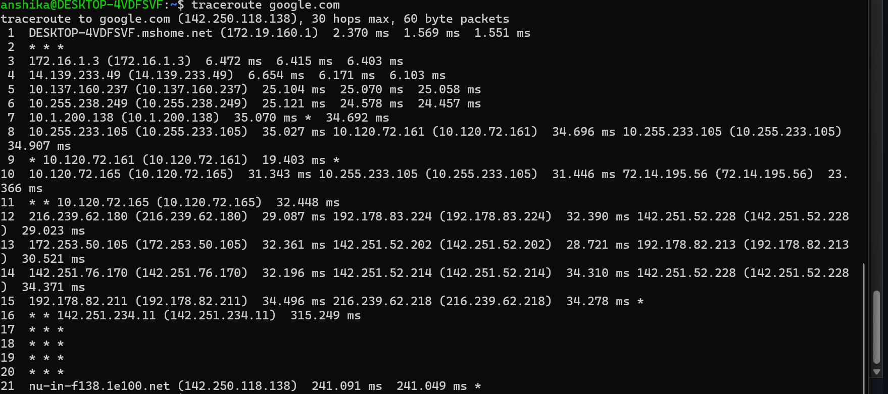

### Overview
This practical applies the networking concepts studied in Month 1 through hands-on Linux exercises.

### Objectives
- Understand local network connectivity.
- Test communication using the loopback address.
- Identify and test the default gateway.
- Investigate communication between devices within a local network.
- Examine the Linux routing table.
- Investigate network paths using traceroute.

### Tools

|Component| Details|
|----|----|
|Operating System| Ubuntu Linux|
|Environment| Linux Terminal|
|Connectivity Tool| ping|
|Routing Tool| ip route|
|Network Path Tool| traceroute|

## Local Connectivity Investigation
- Objective: To test communication within the local Linux system using the loopback address.
- Command: ping -c 4 127.0.0.1
- Explanation
   - "ping" is used to test network connectivity.
   - "-c 4" sends four ICMP packets.
   - "127.0.0.1" is the IPv4 loopback address.
- Evidence:
  
  
  
- Observation
   - The command tests communication with the local system without sending packets to an external network.
   - Successful replies indicate that the local networking stack is responding to the loopback test.

## Gateway Connectivity Investigation
- Objective: To identify the default gateway and test communication between the Linux system and its gateway.
- Observation: The default gateway was successfully identified using the "ip route" command.
   - Observed routing information:
     - Default Gateway: 172.19.160.1
     - Network Interface: eth0
     - Route Protocol: kernel

The gateway IP address was also successfully extracted using a shell variable.

- A connectivity test was performed using:
"ping -c 4 "$GATEWAY""

- The results were:
   - Packets transmitted: 4
   - Packets received: 0
   - Packet loss: 100%

- Evidence

## Routing Table Investigation
- Objective: To inspect the Linux routing table, identify the default gateway, understand the connected network route, and investigate how the system selects a route when communicating with an external IP address.

- Commands Performed:

1. Displaying the Routing Table

ip route

- Observation: The command displayed two routing entries:
   - Default route: "default via 172.19.160.1 dev eth0"
   - Connected network: "172.19.160.0/20 dev eth0"
   - Network interface: "eth0"
   - Source IP address: "172.19.171.1"

2. Identifying the Default Gateway

ip route | grep default

- Observation: The command returned the following entry:
   - default via 172.19.160.1 dev eth0 proto kernel

- Analysis:
   - "default": Represents the default route.
   - "via 172.19.160.1": Identifies the default gateway.
   - "dev eth0": Indicates the outgoing network interface.
   - "proto kernel": Indicates that the route was installed by the kernel.

3. Checking the Route to an External IP Address

ip route get 8.8.8.8

- Observation: The command returned:
8.8.8.8 via 172.19.160.1 dev eth0 src 172.19.171.1 uid 1000

- Analysis: The output identifies how the system would route packets destined for "8.8.8.8".
   - Destination IP: "8.8.8.8"
   - Next-hop gateway: "172.19.160.1"
   - Outgoing interface: "eth0"
   - Source IP address: "172.19.171.1"
   - User ID: "1000"

The system selects the default gateway and uses the "eth0" interface to forward traffic towards the external destination.

- Evidence

  # Cybersecurity Relevance
   -It helps identify:
     - How network traffic leaves a system.
     - Which gateway handles external communication.
     - Which network interface is used for communication.
     - Potentially unexpected or unauthorized routing entries.

## Traceroute Investigation
- Objective: To identify the network path followed by packets when communicating with an external destination and understand how intermediate routers forward network traffic.

- Command Used
traceroute google.com

- Evidence

- Practical Observation
The traceroute command was executed successfully in Ubuntu.

- Destination hostname: "google.com"
- Resolved destination IP: "142.250.118.138"
- Maximum hops: 30
- Destination reached at: Hop 20
- First hop IP address: "172.19.160.1"

- Analysis:
1. First Hop: The packets reached the first network gateway at "172.19.160.1".
2. Intermediate Hops: Several intermediate routers responded and displayed their IP addresses and response times.
3. Non-responsive Hops: Some hops displayed "* * *", indicating that no response was received within the timeout period.
4. Final Hop: The destination IP address "142.250.118.138" was reached at hop 20.

 - Key Learnings:
    - Traceroute identifies the sequence of network hops between the source and destination.
    - Each hop represents an intermediate router or network device responding to a probe.
    - Response times help observe the time taken to receive replies from intermediate hops.
    - Asterisks ("* * *") indicate missing probe responses and do not necessarily mean network failure.
    - Traceroute is useful for investigating routing paths and possible network communication issues.

- Conclusion

This investigation demonstrated how data travels through multiple network devices before reaching an external destination. The traceroute command helped identify intermediate hops, observe response times, and understand how routers participate in forwarding packets across networks.

### Key Findings

Through this practical investigation, I learned:

1. The loopback address is used to test communication within the local system.
2. The default gateway forwards traffic towards other networks.
3. Devices within a LAN can communicate through local network connectivity.
4. The neighbour table provides information about nearby devices.
5. The routing table determines how Linux forwards network traffic.
6. The "ip route get" command helps examine route selection.
7. Ping helps investigate connectivity at different network destinations.
8. Traceroute helps examine intermediate network hops.

