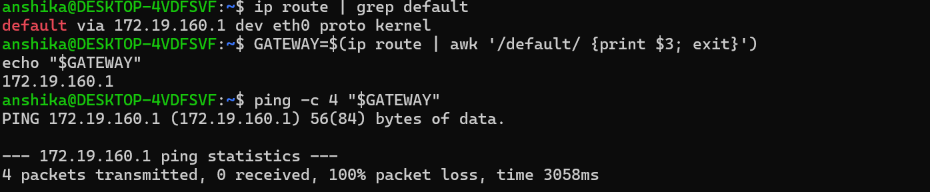

## Local Connectivity Investigation
- Objective: To test communication within the local Linux system using the loopback address.
- Command: ping -c 4 127.0.0.1
- Explanation
   - "ping" is used to test network connectivity.
   - "-c 4" sends four ICMP packets.
   - "127.0.0.1" is the IPv4 loopback address.
- Evidence:
  
  
  
- Observation
   - The command tests communication with the local system without sending packets to an external network.
   - Successful replies indicate that the local networking stack is responding to the loopback test.

## Gateway Connectivity Investigation
- Objective: To identify the default gateway and test communication between the Linux system and its gateway.
- Observation: The default gateway was successfully identified using the "ip route" command.
   - Observed routing information:
     - Default Gateway: 172.19.160.1
     - Network Interface: eth0
     - Route Protocol: kernel

The gateway IP address was also successfully extracted using a shell variable.

- A connectivity test was performed using:
"ping -c 4 "$GATEWAY""

- The results were:
   - Packets transmitted: 4
   - Packets received: 0
   - Packet loss: 100%

- Evidence

## Routing Table Investigation

