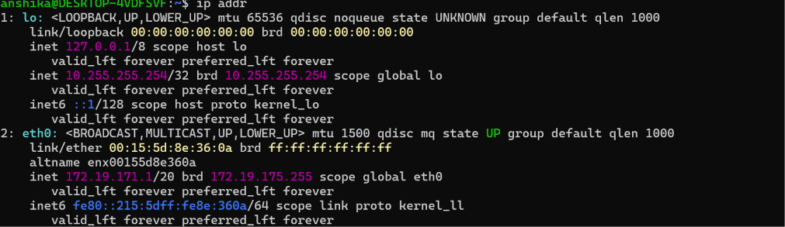
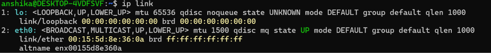
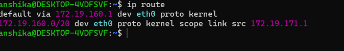

## Network Interfaces
- A network interface is a connection point that allows a computer to communicate with other devices over a network.
- Linux systems can have multiple network interfaces depending on their hardware and configuration.

Common network interface types include:

- Ethernet: A wired network connection.
- Wi-Fi: A wireless network connection.
- Loopback: A virtual interface used for communication within the same system.
- Virtual Interfaces: Interfaces created by virtual machines, containers or other networking software.

## IPv4 Address
- IPv4 (Internet Protocol version 4) is a network addressing system used to identify devices on an IP network.
- It's a numeric address separated by dot(.)
- It's length is 32bits
- Contains 4 octet and 8bits
- Range- 0-255
- Contains 5 classes
- example- 192.168.10.26
   # Types of IPv4 addresses:
   - Private IP: Used within private networks such as home, college and office networks.
   - Public IP: Used for addressing devices or networks on the public Internet.
   - Loopback IP: Used for communication within the same computer.

##  MAC Address
- A MAC (Media Access Control) address is a hardware-level address associated with a network interface.
- It is generally represented as six pairs of hexadecimal characters.
- Example:
    - "00:1A:2B:3C:4D:5E"
- Purpose of a MAC address:
   - Identifies a network interface at the data link layer.
   - Helps devices communicate within a local network.
   - Is used in Ethernet frame delivery.
   - Helps network devices distinguish between interfaces on a local network.

## Loopback Address
- The loopback interface is a virtual network interface that allows a computer to communicate with itself.
- The standard IPv4 loopback address is:
   - "127.0.0.1"
- The entire IPv4 range "127.0.0.0/8" is reserved for loopback.

## IP Configuration
- IP configuration refers to the network addressing information assigned to a network interface.
- Helps a device identify its network and communicate with other devices.
- It includes:
  - IPv4 address.
  - Subnet prefix or subnet mask.
  - Network interface details.
  - Broadcast address

## Subnet Mask and CIDR Notation
- A subnet mask identifies which portion of an IP address represents the network and which portion represents the host.
- Why subnetting is important:
  - Divides large networks into smaller networks.
  - Helps organise network devices.
  - Improves network management.
  - Helps determine whether a destination is local or requires routing.
- (more details learnt  and noted in previous month)

## Default Gateway
- A default gateway is the network device through which a computer sends packets when there is no more specific route available

## Practical Findings:

   # Inspect Network Interfaces and IP Configuration
      - Command executed- ip addr
      - Purpose: This command displays network interfaces along with their IP configuration.
      - My observation:
         - My Ubuntu environment displayed two network interfaces:
            1.Loopback Interface (lo)
               - Interface name: lo
               - IPv4 address: 127.0.0.1/8
               - IPv6 address: ::1/128
               - Additional IPv4 address: 10.255.255.254/32
               - MAC address: 00:00:00:00:00:00
           2. Ethernet Interface (eth0)
               - Interface name: eth0
               - IPv4 address: 172.19.171.1/20
               - MAC address: 00:15:5d:8e:36:0a
               - Broadcast address: 172.19.175.255
               - Interface status: UP
               - Link status: LOWER_UP
       - Subnet Information:
          - IP address: 172.19.171.1
          - CIDR prefix: /20
          - Subnet mask: 255.255.240.0
          - Network address: 172.19.160.0
          - Broadcast address: 172.19.175.255
  - Screenshot
    

   # Inspect Network Interface Status
        - Command executed- ip link
        - Purpose: This command displays network interfaces and their link-layer properties.
        - My observation:
           - Number of interface displayed: 2(lo and eth0)
           - Primary network interface: eth0
           - Interface status: UP(LOWER_UP)
           - MAC address: 00:15:5d:8e:36:0a
           - Loopback interface status: UP
- Screenshot
  

  # Inspect the Routing Table
        - Command executed- ip route
        - My observation:
           - Default gateway: 172.19.160.1
           - Destination network: 172.19.160.0/20
           - Network interface: eth0
           - Source IP address: 172.19.171.1
           - Routing protocol: kernel
  - Screenshot
    

# Practical Understanding:
- The practical concepts covered in this lab are directly related to the networking fundamentals studied in Month1.
-  In this lab, month1 concepts are examined directly through Linux commands.

# Key Learnings
After completing this practical, I learned:

- How network interfaces work in Linux.
- How to identify IPv4 and MAC addresses.
- How the loopback interface functions.
- How to inspect IP configuration.
- How subnet prefixes represent network portions.
- How to identify the default gateway.
- How to inspect Linux routing information.
- How networking concepts are applied in a Linux environment.
- Why network configuration knowledge is important for cybersecurity.
  

 

     
        

