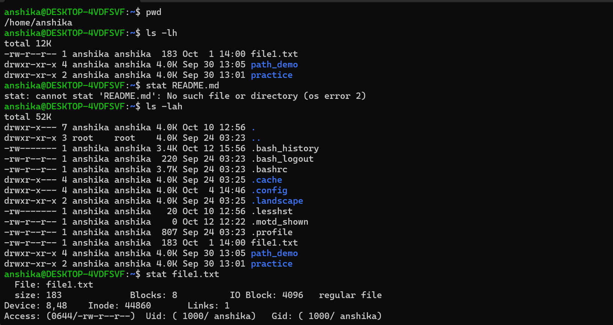

# Objective

To practise inspecting files and directories in Linux, viewing file information, and understanding basic file metadata.

# Commands Practised
   1. pwd- Displays the present working directory, showing the current location in the Linux filesystem.
   2. ls -lh- Lists files and directories in a human-readable long format, displaying details such as permissions, ownership, file size, and modification time.
   3. stat - Displays detailed information about the specified file, including its size, permissions, ownership, and timestamps.

 

# Observations

- The "pwd" command helps identify the current working directory.
- The "ls -lh" command provides a detailed overview of files and directories.
- File sizes displayed by "ls -lh" are easier to read because they use human-readable units.
- The "stat" command provides detailed metadata about an individual file.
- File permissions and ownership information help explain who can access or modify a file.

 # Cybersecurity Relevance

- Inspecting files and directories helps administrators understand the contents of a system.
- Checking file permissions can help identify files with potentially inappropriate access.
- Reviewing ownership information helps administrators understand which users own particular files.
- Examining modification timestamps can help identify changes that may require further investigation.
