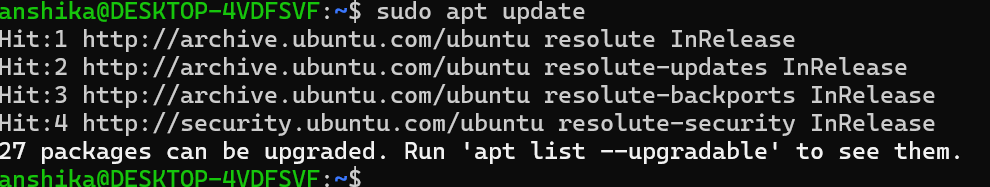

## Objective

To understand how Ubuntu manages software packages using APT (Advanced Package Tool) and practice installing, verifying, and removing a software package.

# Commands Practiced

sudo apt update
apt list --upgradable
sudo apt install tree
tree --version
which tree
sudo apt remove tree

  # Package Installation

  # Package Installed Version

  # Update package lists

# Procedure

1. Updated the package lists using "sudo apt update" to retrieve the latest package information from the configured repositories.
2. Checked for available package upgrades using "apt list --upgradable".
3. Installed the "tree" package using "sudo apt install tree".
4. Verified the installation using "tree --version" and "which tree".
5. Removed the package using "sudo apt remove tree" after completing the practice.

# Observations

- APT is Ubuntu's package management tool for installing, updating, and removing software packages
- The "apt update" command refreshes package information; it does not upgrade installed software.
- The "apt install" command installs a package and its required dependencies.
- The "tree" command displays files and directories in a tree-like structure.
- The "tree --version" command displays version information, while "which tree" shows the executable's location.
- The "apt remove" command uninstalls a package but generally retains its system-wide configuration files.

# Cybersecurity Relevance

- Package management helps keep software organized and maintainable on Linux systems.
- Updating package lists helps identify available software updates, including potential security fixes.
- Installing software from trusted repositories reduces the risk of downloading malicious or modified packages.
- Understanding package installation and removal is useful for Linux system administration and cybersecurity lab environments.

# Conclusion

This task provided practical experience with Ubuntu's APT package manager, including refreshing package information, checking available upgrades, installing a package, verifying its installation, and removing it.
