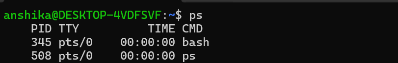
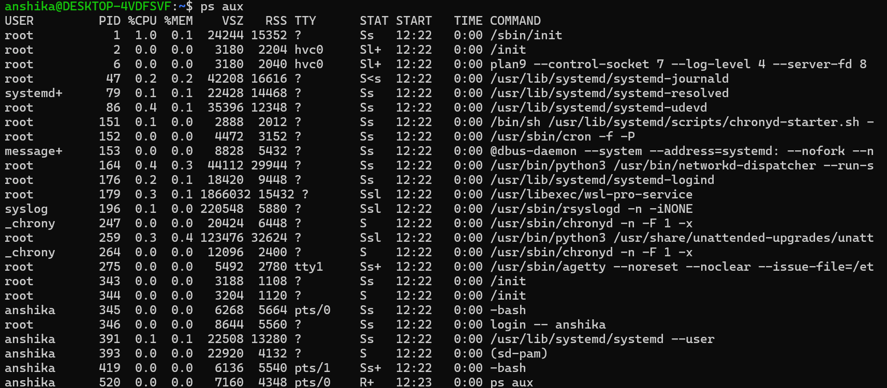
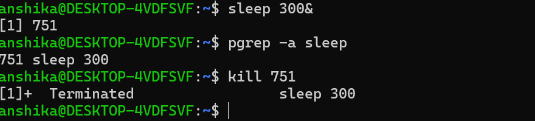

## Process Monitoring in Linux

  # Objective
     - To understand how to view, identify, and monitor running processes in Linux.

   # Commands Practised
   1. ps- Displays processes associated with the current terminal session.
      

      observation
       - This displays processes associated with my current terminal session
      
   2. ps aux- Displays a detailed list of processes running on the system, including CPU and memory usage.
      
         
   4. top- Provides real-time information about running processes and system resource usage.
      [system-resource-monitoring](system-resource-monitoring.png)

      Observation
       - It is displaying live process information and system resource usuage.
         
      5. sleep 300 &- Starts a sleep process in the background for 300 seconds.
      6. pgrep -a sleep- Displays the process ID and command line for matching sleep processes.
      7. kill- Terminates a process using its process ID.
         
         

   # Observations
- Linux assigns process IDs (PIDs) to processes.
- Background processes can run while the terminal remains available for other commands.
- Process monitoring helps administrators identify running programs and observe resource consumption.

   # Cybersecurity Relevance
Process monitoring helps administrators recognise unexpected processes, investigate unusual resource usage, and support basic system troubleshooting.
