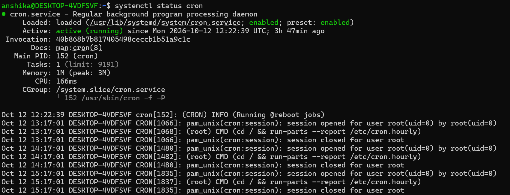
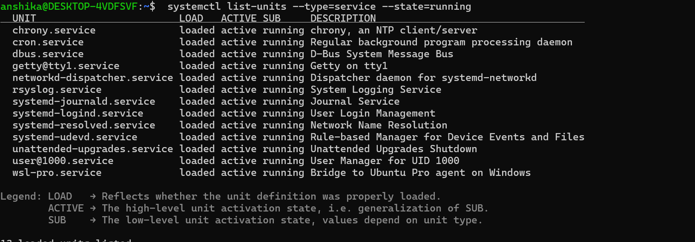

## Objective

To understand how to check the status of Linux services and identify services that are currently running on the system.

## Commands Practised

1. systemctl status cron
     - Checks the current status of the cron service, which is used to schedule tasks in Linux.

2. systemctl list-units --type=service --state=running
     - Displays the currently running services managed by systemd.
     - 

## Observations

- Linux services perform background tasks that support system operations.
- The "systemctl status" command provides information about a specific service, including its current state.
- The "systemctl list-units" command helps identify services that are currently running.

## Cybersecurity Relevance

- Monitoring services helps administrators understand which background components are active.
- Identifying unfamiliar or unexpected services can support basic security checks.
- Checking service status helps with troubleshooting and maintaining system availability.
- Regular service monitoring can help administrators identify services that may require further investigation.

## Conclusion

Practising service monitoring improved my understanding of Linux system administration and how service status information can support basic system maintenance and cybersecurity awareness.
