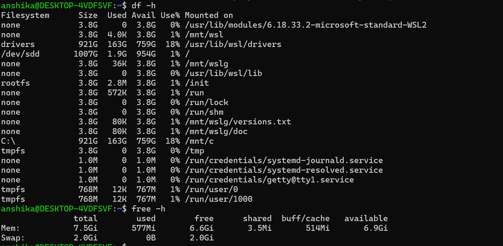
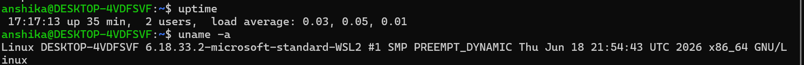

## Checking Disk usage, memory and system information

 # Objective

To inspect system resources and basic system information using Linux commands.

 # Commands Practiced

|Command| Purpose|
|----|----|
|"df -h"| Displays disk space usage in a human-readable format.|
|"free -h"| Displays RAM and swap memory usage in a human-readable format.|
|"uptime"| Displays system uptime, logged-in users, and load averages.|
|"uname -a"| Displays basic system and kernel information.|

 # Screenshots

1. Disk and Memory Usage

   
2. Basic System Information

  
  
 # Observations

- The "df -h" command helps identify available and used disk space across mounted filesystems.
- The "free -h" command provides an overview of memory usage and available RAM.
- The "uptime" command shows how long the system has been running and its current load averages.
- The "uname -a" command displays details such as the kernel name, kernel version, and system architecture.
- These commands help provide a basic overview of system health and resource availability.

  # Cybersecurity Relevance

- Monitoring disk space can help identify storage shortages that may affect system availability.
- Checking memory usage can help identify resource exhaustion that could affect system performance.
- Reviewing uptime and system information helps with basic system administration and troubleshooting.
- Knowing the kernel version is useful when checking for relevant security updates and vulnerabilities.

  # Conclusion

I practiced checking disk usage, memory usage, system uptime, and basic kernel information using Linux terminal commands. This exercise improved my understanding of Linux system resource monitoring and administration.
