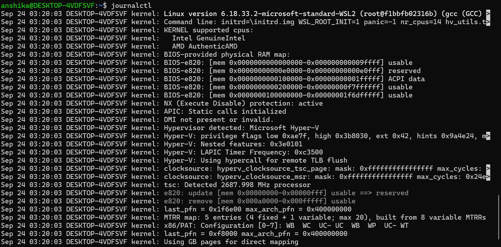
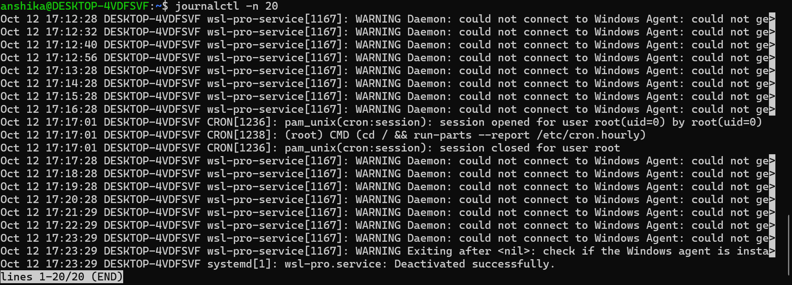
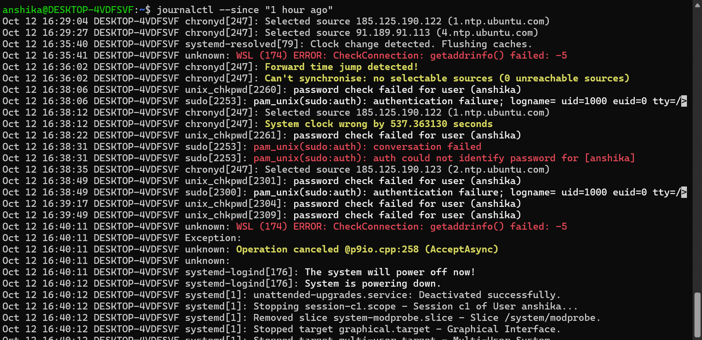

# Objective

To learn how to view and search system logs for basic troubleshooting using the Linux journal.

# Commands Practiced

|Command| Purpose|
|"journalctl"| Displays system journal entries.|
|"journalctl -n 20"| Displays the 20 most recent journal entries.|
|"journalctl --since "1 hour ago""| Displays journal entries from approximately the previous hour.|

# Screenshots

1. Viewing System Logs

2. Viewing the Latest 20 Log Entries

3. Viewing Logs from the Last Hour

# Observations

- Linux system logs record information about system activity and events.
- The "journalctl" command allows users to inspect logs collected by systemd's journal.
- The "-n 20" option limits the output to the 20 most recent entries.
- The "--since "1 hour ago"" option filters entries by time.
- Log output depends on the available journal history and the permissions of the current user.

# Cybersecurity Relevance

- System logs help administrators troubleshoot system errors and service issues.
- Reviewing logs can help identify unexpected events and operational problems.
- Filtering logs by time makes it easier to investigate events within a specific period.
- Regular log review is a useful foundation for learning security monitoring and incident investigation.

# Conclusion

I practiced viewing Linux system journal entries, displaying the latest 20 entries, and filtering logs from the previous hour. This exercise improved my understanding of basic Linux troubleshooting and log monitoring
