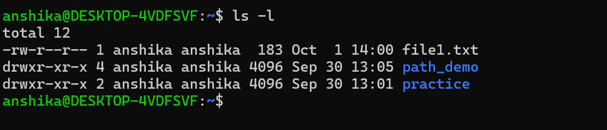
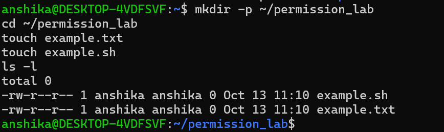

 ## Linux File Permissions
 - Linux uses file permissions to control who can read, modify, or execute files and who can access directories.
 - Permissions help protect files from unauthorized access and accidental modification.
 - Linux permissions are divided into three categories:
     - User (u): The owner of the file.
     - Group (g): Users who belong to the file's associated group.
     - Others (o): All other users who are neither the owner nor members of the associated group.
  # Types of Permissions

|Permission| Symbol| Numeric Value| Meaning for Files|
|----|----|----|----|
|Read| "r"| 4| Allows reading file contents.|
|Write| "w"| 2| Allows modifying file contents.|
|Execute| "x"| 1| Allows executing a file when applicable.|
|No permission| "-"| 0| No permission of that type.|

## Understanding the "ls -l" Command
- The command displays detailed information about files and directories, including their permissions, ownership, size, and modification time.
- Its components are:
    - "-": Indicates a regular file.
    - "rwx": The owner can read, write, and execute.
    - "r-x": The group can read and execute.
    - "r--": Others can read only.

## 4. Symbolic and Numeric Permissions

Linux permissions can be represented symbolically or numerically.
  - Symbolic Notation
    - Examples:
      - "rwxr-xr-x"
      - "rw-r--r--"
      - "rwx------"
  - Numeric Notation
Numeric permissions use the following values:
- Read = 4
- Write = 2
- Execute = 1
- The values are added for each permission category.
- Example: Permission 755
Calculation:
- Owner: "4 + 2 + 1 = 7" → Read, write, execute.
- Group: "4 + 0 + 1 = 5" → Read, execute.
- Others: "4 + 0 + 1 = 5" → Read, execute.

- Symbolic representation: "rwxr-xr-x"
- Example: Permission 644
Calculation:
- Owner: "4 + 2 = 6" → Read, write.
- Group: "4 = 4" → Read only.
- Others: "4 = 4" → Read only.

## Practical
Task1: Inspected exisitng permissions

Observation:
- The command displays file types, permission strings, ownership, file sizes, and modification times.
- Its components are:
    - "-": Indicates a regular file.
    - "rwx": The owner can read, write, and execute.
    - "r-x": The group can read and execute.
    - "r--": Others can read only.

Task2: Create Test Files

Observation:
- mkdir -p ~/permission_lab — created your practice directory.
- cd ~/permission_lab — entered the directory.
- touch example.txt and touch example.sh — created two empty files.
- ls -l — displayed file permissions, ownership, file size, and modification time.
- The permission notation -rw-r--r-- means:
   - Owner (rw-): can read and write.
   - Group (r--): can read only.
   - Others (r--): can read only.
   - at the beginning: indicates a regular file.

Task3: Apply Numeric Permissions

## Key Observations

- Linux permissions control access to files and directories.
- Permissions are assigned to the owner, group, and others.
- Read, write, and execute permissions are represented by "r", "w", and "x".
- The "ls -l" command helps inspect existing permissions.
- Numeric permission values are read = 4, write = 2, and execute = 1.
- Permission 755 corresponds to "rwxr-xr-x".
- Permission 644 corresponds to "rw-r--r--".
- The "chmod" command changes file permissions.

## Cybersecurity Relevance

- File permissions help prevent unauthorized access and modification.
- Restricting write access reduces the risk of unwanted changes.
- Execute permissions help control which files can be executed.
- Appropriate permissions support the principle of least privilege.
- Understanding permissions is essential for Linux administration and cybersecurity.

