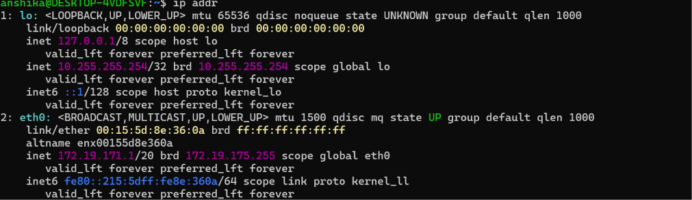
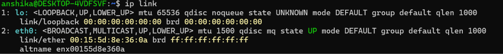
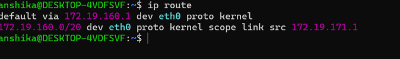
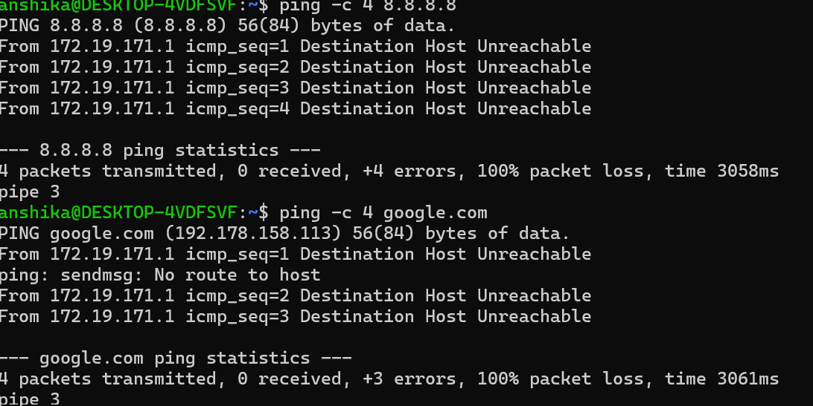
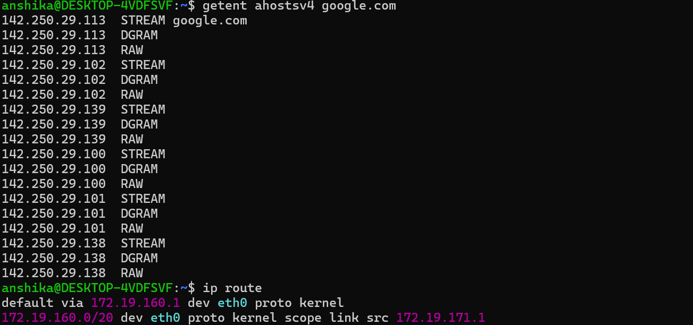
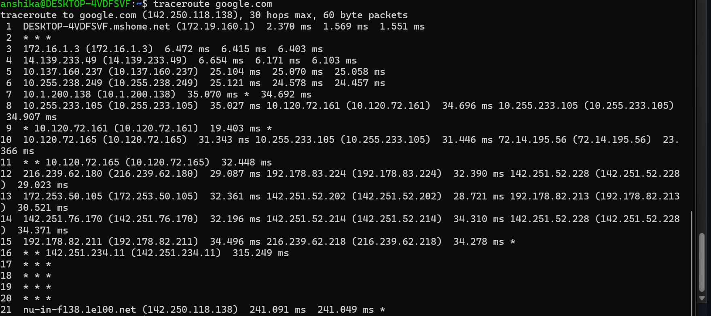
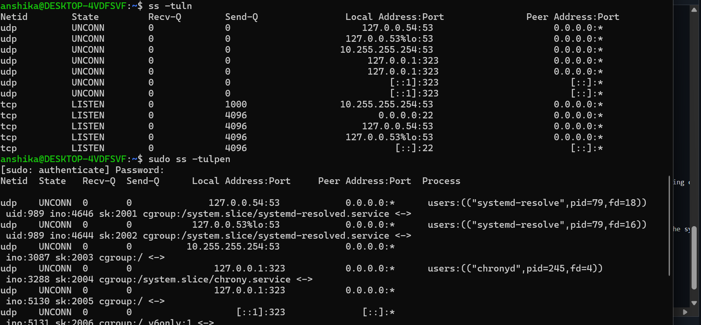
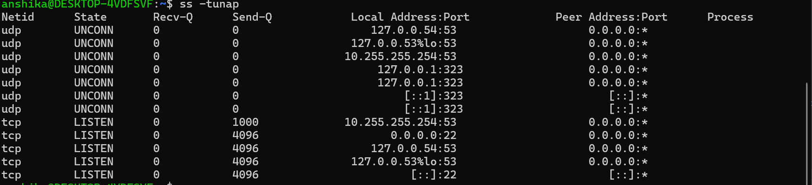

## Linux Network and Security Investigation

 # Project Overview
This project focuses on investigating Linux network configuration, connectivity, routing, DNS resolution, network paths, listening ports, and active network connections using Ubuntu Linux.
The investigation aims to understand how a Linux system communicates over a network, examine its network configuration, identify basic connectivity issues, and observe potential network security concerns.

 # Objectives
The main objectives of this investigation are:

- Examine network interfaces and IP configuration.
- Identify network interface status and MAC addresses.
- Investigate the routing table and default gateway.
- Perform network connectivity tests.
- Understand DNS resolution and DNS server configuration.
- Trace the network path to an external destination.
- Identify listening ports on the Linux system.
- Examine active network connections.
- Perform basic network security observations.
- Understand the importance of Linux networking commands in cybersecurity.

 # Network Interface and IP Configuration
  - Objective: To identify available network interfaces and examine their IP configuration, MAC addresses, and operational status.
  - Investigation: The network interfaces were examined using Linux networking commands to understand how the system is connected to the network.
     - The investigation included:
         - Identifying the available network interfaces.
         - Identifying the primary network interface.
         - Checking interface operational status.
         - Identifying the MAC address.
 - Security Relevance: Network interface investigation helps identify active interfaces, understand the system's network configuration, and establish a foundation for further network security analysis.
 - Evidence:
   
   
   
 # Routing Table Investigation
  - Objective: To examine how network traffic is directed toward local and external destinations.
  - Investigation: The Linux routing table was examined to understand how outgoing network traffic is forwarded.
     - The investigation included:
         - Identifying the default route.
         - Examining the default gateway.
         - Identifying the outgoing network interface.
         - Observing available network routes.
         - Understanding how traffic reaches external networks.
  - Observations:
     - The routing table displayed the available network routes and the default gateway used for forwarding traffic outside the local network.
     - The investigation helped understand the relationship between the destination network, gateway, and outgoing network interface.
 - Security Relevance: Routing table investigation helps identify incorrect routes, unexpected gateways, and potential network configuration problems.
 - Evidence:
   
   

# Network Connectivity Testing
 - Objective: To verify network connectivity between the Linux system and external destinations.
 - Investigation: Connectivity testing was performed using an external IP address and a domain name.
    - The first test examined IP-level reachability, while the second test examined domain-name resolution along with connectivity.
    - The investigation included:
       - Testing connectivity to an external IP address.
       - Testing connectivity using a domain name.
       - Examining transmitted and received packets.
       - Observing packet loss.
- Security Relevance: Connectivity testing helps identify basic network communication problems and provides an initial step in troubleshooting network-related issues.
- Evidence:
  

 # DNS Resolution Investigation
  - Objective: To understand how domain names are translated into IP addresses using the Domain Name System (DNS).
  - Investigation: DNS resolution was investigated using Linux hostname-resolution commands.
    - The "getent hosts" command was used to examine hostname resolution, while "getent ahostsv4" was used to retrieve IPv4 address information for the domain.
    - The DNS resolver configuration was also examined using "/etc/resolv.conf".
  - Observations:
    - Successfully resolved "google.com" into IPv6 addresses.
    - Successfully retrieved multiple IPv4 addresses for "google.com".
    - Observed that multiple IP addresses can be associated with a single domain name.
 - Security Relevance: DNS investigation helps understand hostname resolution, identify DNS configuration issues, and investigate domain-related network communication.
 - Evidence:
   

# Traceroute Investigation
 - Objective: To investigate the network path followed by packets from the Linux system to an external destination.
 - Investigation: Traceroute was used to examine the intermediate network hops between the source system and the destination.
    - The investigation included:
    - Identifying intermediate network hops
    - Observing the route toward the destination.
    - Examining response times for available hops.
    - Observing hops that did not return responses.
    - Understanding how data travels across multiple networks.
- Security Relevance: Traceroute is useful for understanding network paths, identifying possible routing issues, and investigating unexpected network delays.
- Evidence:
  

 # Listening Ports Investigation
  - Objective: To identify network ports that are listening for incoming connections on the Linux system.
  - Investigation: The listening ports were examined using the "ss" command.
     - The investigation included:
       - Identifying TCP listening ports.
       - Identifying UDP listening ports.
       - Examining local IP addresses and port numbers.
       - Observing listening network sockets.
       - Identifying associated processes where available.
   - Note:
      - "-t": Displays TCP sockets.
      - "-u": Displays UDP sockets.
      - "-l": Displays listening sockets.
      - "-n": Displays numerical addresses and port numbers.
      - "-p": Displays associated processes.
      - "-e": Displays extended socket information.
 - Observations: The listening socket information was examined to understand which network ports were available for incoming communication.
   - The results helped identify listening TCP and UDP ports and their associated local addresses.

 - Security Relevance:
Listening port investigation is important in cybersecurity because unnecessary or unexpected open services may increase the system's attack surface.
Identifying listening ports helps determine which services may require further security review.

 - Evidence:
   
   
# Active Network Connections Investigation
- Objective: To examine active network connections and understand how the Linux system communicates with other devices.
- Investigation: The active network connections and socket information were examined using the "ss" command.
   - The investigation included:
      - Examining TCP connections.
      - Examining UDP sockets.
      - Identifying local and remote addresses.
      - Observing connection states where applicable.
      - Identifying associated processes when available.
  -  Note:
     - "-t": Displays TCP sockets.
     - "-u": Displays UDP sockets.
     - "-n": Displays numerical addresses and port numbers.
     - "-a": Displays all sockets.
     - "-p": Displays associated processes.
- Observations: The command provided information about network sockets and connections present on the Linux system at the time of investigation.
- Security Relevance: Monitoring active connections helps understand network communication and identify unfamiliar or unexpected connections that may require further investigation.
- Evidence
 

# Basic Network Security Observations
The following areas were considered during the security investigation:

1. Network Interface Configuration

- Examined available network interfaces.
- Checked interface status and IP configuration.
- Reviewed the network configuration for unexpected interfaces or addresses.

2. Routing Configuration

- Examined the default gateway.
- Reviewed the available routes.
- Considered whether the routing configuration appeared consistent with the expected network setup.

3. DNS Configuration

- Identified the configured DNS resolver.
- Examined DNS resolution results.
- Considered the importance of reliable DNS configuration.

4. Listening Ports

- Identified listening TCP and UDP ports.
- Reviewed associated services and processes where available.
- Considered whether any unnecessary listening services required further investigation.

5. Active Network Connections

- Examined active network sockets.
- Reviewed local and remote addresses.
- Considered whether any unfamiliar connections required further investigation.

## Overall Findings
The Linux Network and Security Investigation provided practical experience in examining the network configuration and communication activities of a Linux system.

The investigation covered:

1. Network interface and IP configuration.
2. Routing table and default gateway.
3. Network connectivity testing.
4. DNS resolution and DNS configuration.
5. Network path investigation using traceroute.
6. Listening TCP and UDP ports.
7. Active network connections.
8. Basic network security observations.

The Linux networking commands helped examine different aspects of network communication and provided an understanding of how network configuration and services can be investigated.

## Conclusion
This project provided practical experience in Linux networking and basic network security investigation using Ubuntu Linux.
Through this investigation, I learned how to examine network interfaces, identify IP configurations, investigate routing information, test network connectivity, and understand DNS resolution.
I also explored traceroute for network path investigation and used the "ss" command to examine listening ports and active network connections.
The security observations helped me understand the importance of monitoring network services, reviewing open ports, and examining communication endpoints.
 

