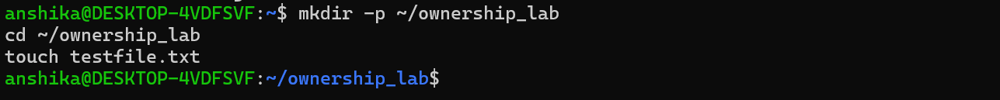
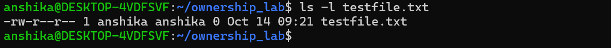
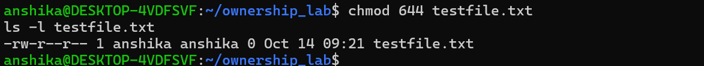
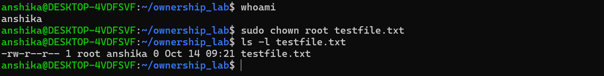
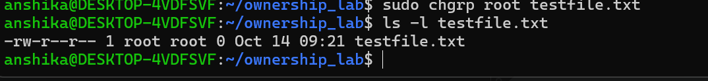

## Ownership
- Linux uses an ownership and permission system to control access to files and directories.
- Every file and directory has an associated user owner, a group owner, and permission settings.
- 3 main components are:
   - User Owner: The user account that owns the file.
   - Group Owner: The group associated with the file.
   - Permissions: The access rights assigned to the owner, group, and others.
 # File Ownership
- File ownership identifies the user account associated with a file or directory.
- The owner may have read, write, and execute permissions depending on the file's permission settings.
    # Importance:
        - Controls access to personal and system files.
        - Helps prevent unauthorized modifications.
        - Supports secure administration of Linux systems.
        - Helps maintain separation between different user accounts.
   # Checking the Current User
  - whoami
  - This command displays the username of the currently logged-in user.
 # Group Ownership
- Group ownership associates a file or directory with a particular Linux group.
- Groups allow administrators to manage access for multiple users without configuring each user's access separately.
   # Benefits:
       - Simplifies access management for multiple users.
       - Supports collaboration on shared resources.
       - Helps enforce access control policies.
       - Reduces the need to assign permissions individually.
  # Viewing Group Ownership
  - ls -l testfile.txt

## The "chown" command
- It changes the user owner of a file or directory. It can also change the group owner.
- Syntax:
   - sudo chown username filename
- Example:
   - sudo chown student testfile.txt
   - This assigns "testfile.txt" to the user "student", provided the account exists and the operation is authorized.
## Changing Both User and Group Ownership
- sudo chown student:developers testfile.txt
- This sets the user owner to "student" and the group owner to "developers".
# Verification
- ls -l testfile.txt

## The "chgrp" command
- The "chgrp" command means change group. It changes the group associated with a file or directory.
- Syntax:
   - sudo chgrp groupname filename
- Example:
   - sudo chgrp developers testfile.txt
 # Verification
- ls -l testfile.txt
- The new group owner should appear in the command output.

## Understanding Sudo
- "sudo" is commonly expanded as superuser do.
-  It allows an authorized user to execute a command with elevated privileges according to the system's configuration.
-  Administrative commands may require "sudo".
    # Update package information:
       - sudo apt update
    # Check the status of a service:
       - sudo systemctl status cron
 # Sudo Importance
 - Allows authorized users to perform administrative tasks.
- Avoids the need to use the root account for routine work.
- Helps limit privileged actions to specific commands.
- Supports safer system administration when used carefully.

## Root Privileges
- The root user is the superuser in Linux
- Root privileges can allow a user to:
   - Install, update, and remove software.
   - Create and manage users and groups.
   - Change file ownership and permissions.
   - Modify protected system configuration files.
   - Manage system services and processes.
- RISKS INVOLVED:
   - Accidental deletion or modification of important files.
   - Exposure of sensitive information.
   - Incorrect system configurations.
   - Increased impact if a command or script is malicious.

## Principle of Least Privilege
- The principle of least privilege means giving a user or process only the permissions required to perform its task.
- BENEFITS:
   - Reduces the risk of unauthorized access.
   - Limits the damage caused by mistakes or compromised accounts.
   - Helps protect sensitive files and system resources.

## Practical Lab: Ownership and Privilege Management
Task 1: Created a Test File

Task2: Inspected Ownership and Permissions

Task3: Changed File Permissions

Task4: Change user ownership

Task5: Changed group ownership

## Cybersecurity Relevance
- Ownership and privilege management are essential to Linux security.
- Incorrect ownership, excessive permissions, and unnecessary administrator access can expose sensitive information or allow unauthorized changes.

## My Learning
After completing this lab, I learned:

- How Linux identifies file owners and group owners.
- How to inspect ownership and permissions using "ls -l".
- How to change user ownership with "chown".
- How to change group ownership with "chgrp".
- How "sudo" provides authorized elevated privileges.
- Why unrestricted root access can create security risks.
- How the Principle of Least Privilege supports secure access control.
- How to practice ownership and permission management safely on test files.
  

