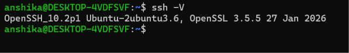
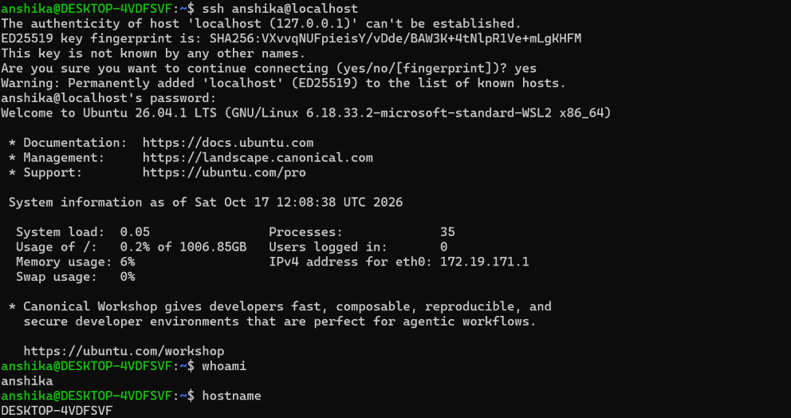
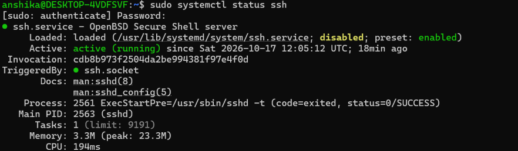
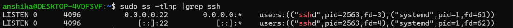

## What is SSH?
- SSH stands for Secure Shell
- It is a network protocol used to securely access and manage a remote computer over an unsecured network.
# Usage 
It is commonly used by Linux administrators and cybersecurity professionals to:
- Access remote Linux servers.
- Execute commands on remote systems.
- Manage servers securely.
- Transfer files securely using related tools such as SCP and SFTP.
- Perform remote system administration and troubleshooting.

# Difference between SSH Client and SSH Server
|Basis|	SSH Client|	SSH Server|
|----|----|----|
|Meaning|	Software used to connect to another computer|	Software that accepts SSH connections|
|Purpose|	Initiates the connection|	Receives and manages the connection|
|Role|	Client/user side|	Remote computer side|
|Common command| ssh command	|sshd service|
|Default port	|Connects to port 22 by default|	Listens on port 22 by default|
|Example|	Your Windows PC connecting to Ubuntu|	Ubuntu computer accepting your connection|

# Remote Login Using SSH
- Remote login means accessing another computer through a network instead of physically using that computer.
- SSH allows an authorized user to log in to a remote Linux machine and execute commands through a terminal.

   # General SSH Command
      ssh username@server_ip
      Here:
        - "ssh" starts the SSH client.
        - "username" is the account on the remote machine.
        - "server_ip" is the IP address or hostname of the remote machine.
# SSH Authentication
- SSH authentication is the process of verifying the identity of a user who wants to access a remote system.

   # Authentication methods:
      - Two common authentication methods are:
      - A. Password Authentication- The user authenticates using the password associated with their remote account.
             - Security considerations:
                   - Use strong, unique passwords.
                   - Avoid sharing passwords.
                   - Follow the server's authentication and access policies.
      - B. Public-Key Authentication- Public-key authentication uses a cryptographic key pair:
            - Private key: Kept secret by the user.
            - Public key: Placed on the remote server, usually in the user's "~/.ssh/authorized_keys" file.
# Important SSH security practices
- Use strong, unique passwords when password authentication is enabled.
- Prefer SSH public-key authentication where appropriate.
- Protect private SSH keys and never share them.
- Allow SSH access only to authorized users.
- Keep the SSH server and operating system updated.
- Disable root SSH login when it is not required and the system's administration policy permits it.
- Use appropriate firewall rules to restrict network access to SSH.

  # Basic SSH Commands (Practiced)
  - Task1: Checked the SSH Client Version
     - objective:- To verify that openSSH client is installed and check its version

  
    - Result- Helped me verify SSH client availability.

  - Task2: Connecting to a remote server
     - objective: To establish a secure connection to another computer or server using SSH
     - Syntax: ssh username@server_ip
     - ssh- Starts the SSH client
     - username- account name on the remote server
     - server_ip- IP address of remote server

 

 - Task3: Check SSH Server Service Status
     - objective- Checks the status of the SSH server service, if installed.
  

- Task4: Check Whether the SSH Server Is Listening
     - objective: to check for listening socket TCP socket on port 22

    - Herein:
        - LISTEN — the server is listening for incoming connections.
        - :22 — SSH is listening on port 22.
        - sshd — the SSH server process.
        - 0.0.0.0:22 — listening on port 22 on all IPv4 interfaces.
        - [::]:22 — listening on port 22 on all IPv6 interfaces.
        
## What I learned 
- An SSH client can be installed without an SSH server.
- Learned the basics of remote login.
- Understood  password and public-key authentication.
- Learnt to check the service status.
- A successful remote connection requires a reachable server, a listening SSH service, and valid authentication.
- Do not attempt to connect to systems without authorization.

 
  
  

  
  
  

