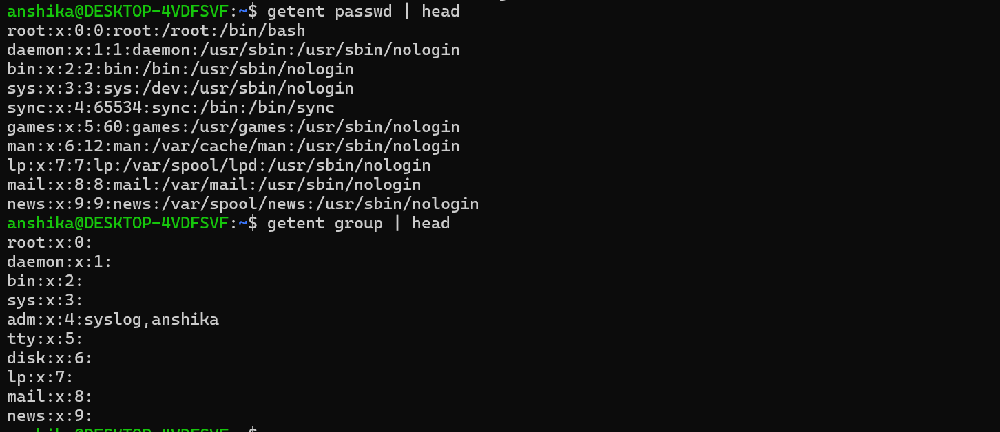
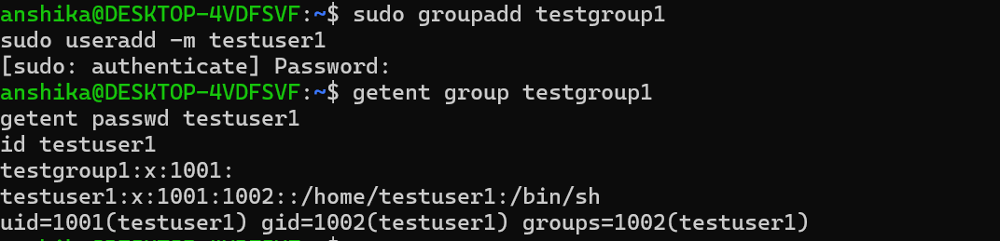

## Linux Users
- Linux is a multi-user operating system that allows multiple users to access the same system with different permissions.
- Each user account has a unique User ID (UID), which Linux uses to identify the user.
  # Types of Users
  1.Root User
   - The root user is the superuser in Linux.
   - It has extensive administrative privileges.
   - It can manage user accounts, install software, and modify system configurations.
   - The root user normally has UID 0.
  2.Normal User
   - A normal user has limited permissions compared with root.
   - It can access personal files and perform tasks permitted by the system.
## Linux Groups
- A group is a collection of users managed together to simplify permission and access management.
- Groups allow administrators to assign permissions to multiple users without configuring each user individually.
- Each group has a Group ID (GID), which Linux uses to identify the group.
  # Types of Group Membership
1.Primary Group
- Every user has a primary group.
- It is commonly used as the default group for files created by the user.
2.Supplementary Groups
- A user can belong to additional groups.
- Supplementary groups can provide access to shared files, directories, and other resources.
  

  # Important Linux User Files
|File| Purpose|
|----|----|
|/etc/passwd"| Stores basic user account information, including usernames, UIDs, GIDs, home directories, and login shells.
|"/etc/group"| Stores local group information, including group names, GIDs, and supplementary group member lists.
|"/etc/shadow"| Stores password hashes and password-related account information. Access is restricted.
  # Commands Practiced
|Command| Purpose|
|----|----|
|"whoami"| Displays the effective username of the current process.|
|"id"| Displays the current user's UID, primary GID, and group memberships.|
|"id username"| Displays identity information for a specified user.|
|"who"| Displays logged-in user sessions recorded by the system.|
|"cat /etc/passwd"| Displays user account entries.|
|"cat /etc/group"| Displays local group entries.|
|"getent passwd username"| Looks up a specific user account.|
|"getent group groupname"| Looks up a specific group.|
|"sudo useradd -m testuser1"| Creates a test user and requests creation of a home directory.|
|"sudo groupadd testgroup1"| Creates a group named "testgroup1".|

  # Practical
   Task 1: Identified the Current User
 
 Observation:
- "whoami" displays the effective username.
- "id" displays the UID, GID, and group memberships.

  Task 2: Inspected User and Group Information
  
  Observation:
  - I used getent passwd | head &getent group | head for shorter output.
  - These commands help inspect local user accounts and group information.
  - cat /etc/passwd & cat /etc/group (these commands are used for longer output)

  Task3: Created a Test User and Group
  
  Observation:
  - The commands created a test group and user.
  - The verification commands help confirm that the accounts exist and display their identity information.

## Key Observations

- Linux supports multiple user accounts with different permissions.
- The root user has UID 0.
- A UID identifies a user, while a GID identifies a group.
- Every user has a primary group and may have supplementary groups.
- "/etc/passwd" contains basic local user account information.
- "/etc/group" contains local group information.
- The "id" and "groups" commands help inspect group membership.
- Group-based access control simplifies permission management.

## Cybersecurity Relevance

- User accounts help control access to a Linux system.
- Groups simplify access management for shared resources.
- Reviewing user and group information helps administrators understand access rights.
- Proper user and group management helps reduce unauthorized access risks.

